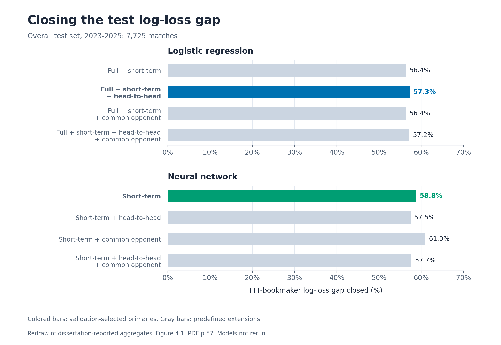
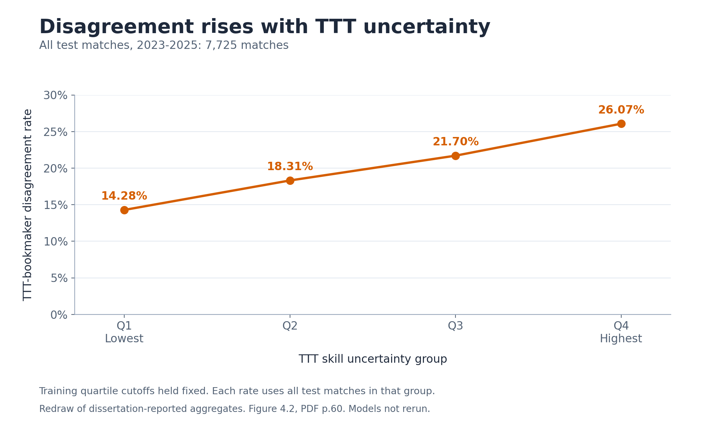
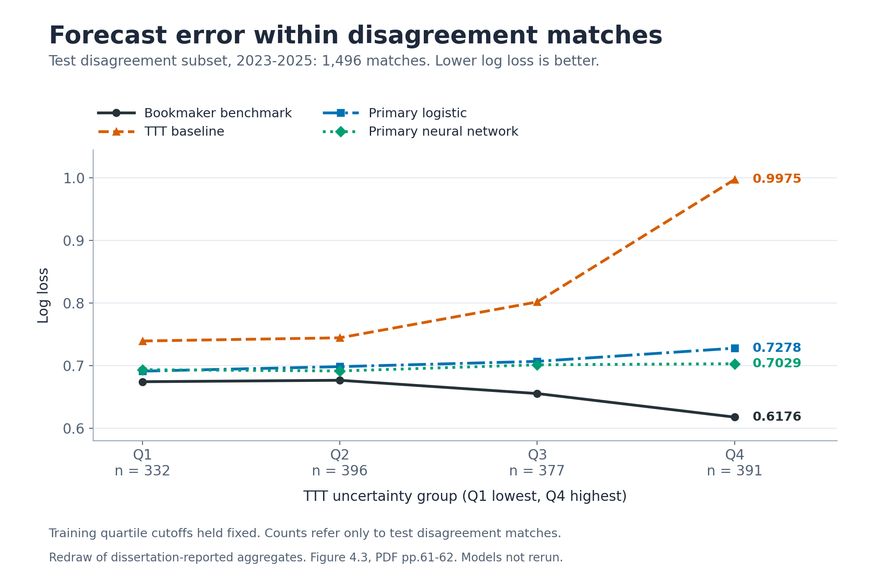

# When Ratings and Markets Disagree: ATP Tennis Forecasting with TTT and Pre-Match Covariates

**Zhiheng Huang**  
Developed from an MSc dissertation in Statistics and Sustainability, Trinity College Dublin, August 2026.

## Overview

TrueSkill Through Time (TTT) summarizes changing player strength from match history. This study asks how much public information about ranking, form, surface, workload and matchup history can improve its probability forecasts relative to a bookmaker benchmark.

Chronological model selection and daily rolling-origin evaluation support that comparison. Disagreement and uncertainty diagnostics examine where the rating forecast diverges from the market. All findings below are **dissertation-reported results**. The three figures redraw checked, rounded aggregates; the statistical pipeline has not been independently rerun for this repository.

## Research questions

1. How much of the TTT-bookmaker forecasting gap can pre-match covariates recover?
2. How often do TTT and the bookmaker predict different winners, and how do the covariate models perform in those matches?
3. How do disagreement frequency and prediction error vary with TTT skill uncertainty?

## Data

The analytical sample contains **39,154 completed ATP men's singles matches and 1,091 players**, covering 2010-2025. Only matches with usable bookmaker probabilities are retained. The source spreadsheets are absent, and these counts are dissertation-reported rather than rerun here.

**Publication note:** The author confirms permission for public portfolio display of the rounded aggregate research results and figures in this repository. The annual Tennis-Data workbooks, match-level records and other source datasets are not included. The aggregate findings are attributed to the author’s MSc dissertation and to Tennis-Data as the underlying match/odds source. This permission does not grant a licence to third-party source data.

| Partition | Years | Matches | Purpose |
|---|---|---:|---|
| Training | 2010-2021 | 28,890 | Initial fitting and preprocessing |
| Validation | 2022 | 2,539 | Model and hyperparameter selection |
| Test | 2023-2025 | 7,725 | Sequential forecasting evaluation |

Underlying annual match and bookmaker-odds workbooks are from [Tennis-Data](https://www.tennis-data.co.uk/); the workbooks and match-level derivatives are not included. [Data requirements](data/README.md) describe filenames, schema and local placement.

## Evaluation design

The periods are chronological, with no random data split. All forecasts target Player A's win probability; randomized A/B labels are fixed independently of the time partitions.

Before each test date, logistic coefficients and NN weights are refitted using completed matches strictly before that date. Same-date forecasts precede outcome updates. Feature sets, hyperparameters, training imputation values and scaling remain fixed after validation. Historical covariates exclude the current date. TTT uses annual historical refits and daily prediction-before-update processing.

## Models and features

| Forecast | Role |
|---|---|
| Bookmaker | External benchmark: mean of available individual-bookmaker probabilities after margin normalization. Aggregate average/maximum odds are excluded. Market probabilities are not model predictors. |
| TTT | Dynamic skill baseline with pre-match win probability and combined skill uncertainty. |
| Logistic regression | Eight predefined candidates. Validation log loss selects **full + short-term + head-to-head** as primary. |
| Feedforward neural network | Four feature families with validation-selected hidden size, weight decay and initialization. The primary **short-term** family includes full base covariates and short-term workload/rest, without relational extensions. |

The final primary NN uses a 1,000-iteration optimization cap; the three predefined NN extensions retain the original 300-iteration cap. Primary identities are fixed by validation performance.

| Feature group | Pre-match information |
|---|---|
| TTT outputs | Logit win probability and uncertainty of the skill difference |
| Ranking and points | Directional advantages and absolute gaps |
| Form, surface and experience | Career, previous-five/ten and surface win rates; earlier match counts |
| Context | Surface, tournament series and round |
| Rest and workload | Rest days, previous-match games, 30-day counts and seven-day measures |
| Matchup history | Earlier head-to-head meetings and records against common opponents |

Games and match counts are workload proxies. [Pipeline notes](reproducibility/pipeline.md) give the historical-information rules and final NN provenance.

## Metrics and key results

**Log loss** is the primary forecasting and validation metric. Brier score and classification accuracy complement it. Lower log loss/Brier score and higher accuracy indicate better performance.

Reported overall test performance (Table 4.3, one-based PDF viewer p.55):

| Forecast | Log loss | Brier score | Accuracy |
|---|---:|---:|---:|
| Bookmaker benchmark | **0.5866** | **0.2019** | **68.13%** |
| TTT baseline | 0.6576 | 0.2275 | 63.70% |
| Primary logistic regression | 0.6169 | 0.2148 | 65.48% |
| Primary neural network | 0.6159 | 0.2143 | 64.96% |

The bookmaker remains the strongest benchmark. Primary logistic and NN models close **57.3%** and **58.8%** of the overall TTT-bookmaker test log-loss gap (Figure 4.1, PDF p.57). Gap closure measures improvement from TTT toward bookmaker log loss, divided by that benchmark gap.

The common-opponent NN extension records the lowest observed test log loss among fitted models, **0.6143**, and **61.0%** gap closure. It remains an extension because it was not the validation-selected primary (Table 4.4/Figure 4.1, PDF pp.56-57).

TTT and the bookmaker disagree on **7,145/39,154 matches (18.25%)** in the full sample and **1,496/7,725 (19.37%)** in testing. Within those **1,496 test disagreement matches**, primary logistic and NN log loss are **0.7065** and **0.6973**, versus TTT **0.8239** and bookmaker **0.6553**. The primaries close **69.6%** and **75.1%** of this separate within-subset gap (Tables 4.5/4.7, PDF pp.58-60).

Disagreement means different predicted winners at a 0.5 threshold. Uncertainty groups use training-derived quartile cutoffs held fixed in testing; test groups need not be equally sized. Disagreement rises from **14.28% in Q1** to **26.07% in Q4** (Figure 4.2, PDF p.60).

## Key figures

Each image is a **redraw of dissertation-reported aggregates**, generated with Python/Matplotlib and checked against the final PDF. No model was rerun.



**Figure 1.** Overall test gap closure, n = 7,725. Published Figure 4.1 percentages are retained; recalculating from rounded log-loss tables can differ at the displayed precision.



**Figure 2.** Rates use all test matches in each group, rather than the disagreement subset.



**Figure 3.** Within the 1,496 test disagreement matches, both primaries improve on TTT in every group. Separation is greatest in Q4: TTT 0.9975, primary logistic 0.7278, primary NN 0.7029 and bookmaker 0.6176 (Figure 4.3, PDF pp.61-62).

## Reproducibility

Scripts **01-14 are unchanged from Phase 1**. Run order: 01-04 preparation; 05 TTT; 06-09 covariates; 10 logistic models; 11-13 NN comparisons, convergence sensitivity and final primary rerun; 14 diagnostics. Use fresh R processes from the repository root. Fitting can require substantial computation; checkpoints need provenance checks.

The dissertation reports R 4.5.2, `readxl` 1.4.5, `TrueSkillThroughTime` 1.0.0 and `nnet` 7.3-20. The code also requires `hash`; its original version is unknown. See [environment](reproducibility/environment.md), [dependencies](reproducibility/dependencies.md), [source map](reproducibility/source_map.md) and [Phase 1 edits](reproducibility/code_edits.md).

**R is unavailable: no R parsing/execution, model fitting, match-level verification or full reproduction was performed.** Python plotting, aggregate arithmetic, asset/link checks and script-byte comparisons were executed. These verify presentation and provenance, not independently reproduced forecasts.

To redraw only the reviewed aggregates, from the repository root:

```sh
python3 reproducibility/make_portfolio_figures.py
```

This is the executed presentation path. The base R alternative, **supplied but untested**, is `Rscript --vanilla R/15_make_portfolio_figures.R`. Script 15 is a standalone presentation helper, not a research pipeline stage. Either helper writes the same three PNG paths. [Figure provenance](reproducibility/portfolio_figures.md) documents inputs, tools and precision limits.

## Attribution and reuse

The figures redraw rounded, dissertation-reported aggregates; the portfolio figure scripts did not rerun the statistical pipeline. Research: Zhiheng Huang, *When Ratings and Markets Disagree: TTT-Informed Covariate Models for Tennis Match Prediction*, MSc dissertation, Trinity College Dublin, 2026. Underlying match/odds source: [Tennis-Data](https://www.tennis-data.co.uk/). Original workbooks are not redistributed. No explicit open-source licence is granted for this repository, and no blanket licence is granted to third-party content.

## Limitations

- Coverage is limited to completed ATP men's singles matches with usable bookmaker probabilities.
- Public covariates omit direct injury, travel, motivation and late-information measures; workload proxies do not measure fatigue directly.
- Bookmaker forecasting/pricing processes are unobserved, so their advantage cannot be assigned to a particular method or information source.
- Uncertainty patterns are associations, not causal effects. Small extension differences are descriptive, especially given their different NN iteration cap.
- Prediction-error comparisons do not establish betting profitability.

## Academic context

Based on *When Ratings and Markets Disagree: TTT-Informed Covariate Models for Tennis Match Prediction*, submitted for the MSc in Statistics and Sustainability at Trinity College Dublin, August 2026. This is a dissertation project, not a peer-reviewed publication. The original PDF and reference page images are excluded.
